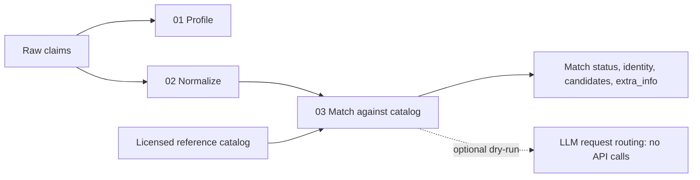

# AutoBrands

**Explainable vehicle make/model entity resolution for noisy records.**

Python pipeline for profiling, normalizing and matching vehicle descriptions against a reference catalog. Supports Greek/Latin comparison views, typo-tolerant candidate retrieval, cross-field recognition, conservative ambiguity handling, and an `extra_info` output for selected reported attributes.

## What it does

- **Profiling:** missing fields, repeated values, mixed writing systems.
- **Preprocessing:** Unicode case/spacing normalization and an additional Greek-to-Latin comparison channel, preserving source text.
- **Entity resolution:** exact, alias, catalog-aware fuzzy and contextual matching, with ranked candidates.
- **Safeguards:** model numbers, variants, brand/model conflicts and abstention.
- **Explanations:** status, method, score, candidates, quality flags and `extra_info`.
- **Optional LLM routing dry-run:** produces validated candidate-selection plans without making API calls. Actual LLM model inference is **not** a feature of this release.

## Quick start (Python 3.10+)

```bash
python -m pip install -r requirements.txt
python 01_explore.py data/demo_claims.csv
python 02_normalize.py data/demo_claims.csv output/demo_normalized.csv
python 03_match.py --input output/demo_normalized.csv --catalog data/demo_catalog.csv --output output/demo_matched.csv
python -m unittest discover -s tests -v
```

Outputs are written to `output/`, which is excluded from version control. No API credentials are required.

For a larger dataset, provide a CSV with columns `claim_id,brand,model` and a properly licensed reference CSV with `brand,model,vehicle_type,aliases,source`, then pass the appropriate input/catalog paths. Do **not** use demo catalog coverage to draw conclusions about production accuracy.

## How it works



## Output interpretation

`EXACT_MATCH`, `ALIAS_MATCH`, `FUZZY_MATCH` are automatic identity selections; `PARTIAL_MATCH` is incomplete; `AMBIGUOUS`, `CONFLICT`, `UNRESOLVED` do **not** assert a full identity. `match_score` is a text similarity measure, **not a calibrated probability**. `extra_info` is reported source text, **not independently validated vehicle specifications**.

| Example input | Intended behavior |
|---|---|
| `SUSUKI / Swift` | Candidate correction to Suzuki / Swift |
| `Toyota / Yaris Cross` | Preserve model family `Cross` |
| `Toyota / Land Cruiser DIESEL` | Preserve reported `DIESEL` as possible extra information |
| `Tesla / Mode` | Abstain without a unique model |
| `Yamaha / MT-09` | Never conflate model number with `MT-07` |

## Measured development results (historical, not a release accuracy estimate)

On a 15,000-row **synthetic** claims set with a larger external reference catalog, the latest candidate version returned **5,702 full matches (38.0% coverage)**. This is not precision, recall or verified correctness. A prior independent 5,000-case multilingual synthetic benchmark produced **97.81% accepted-match precision** and **33.20% identifiable recall**, **on an earlier pipeline version**: these figures must **not** be attributed to this final release. Its difficult cohorts exposed limitations in Greek context and multiple corruptions.

The system has also been run on public Craigslist and UK MOT records using distinct inputs and substantial caching. Reported full-match coverage was 44.60% (Craigslist) and 72.81% (MOT) on an earlier version; **real-world accuracy is not independently verified**. The MOT run benefited from repeated inputs and should not be read as a benchmark for 42M distinct strings.

## Known limitations

Catalog incompleteness and duplicate physical identities; generic or abbreviated names; difficult model codes; uncertain supplemental text; artificial transliterations in synthetic evaluations; lack of human-verified real-world precision; high-confidence wrong matches remain possible. Always inspect outcomes before using them in consequential workflows.

## Data provenance and licensing

Source code: MIT (`LICENSE`). Demonstration claims: CC0-1.0, to the extent of contributors' rights. Demo reference is a small curated list of publicly known names, **not** a redistributable full third-party dataset. Full `vehicle_catalog.csv`, cached datasets, original outputs, external benchmark corpora and potential restricted alias files are **not** published here pending source-by-source rights review. See `data/README.md`.

## Project structure

- `01_explore.py` — descriptive profiling
- `02_normalize.py` — catalog-independent preprocessing
- `03_match.py` — matching, decisions and optional routing dry-run
- `data/` — included synthetic demo and small demo catalog
- `tests/` — lightweight reproducible smoke tests

## Roadmap

Independent labeling with native-speaker validation; external-catalog coverage audit; improved acceptance calibration; optional cost-bounded LLM assistance (currently dry-run only).